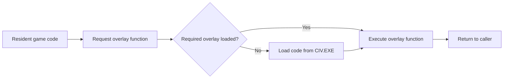

# Overlay Lifecycle

All 23 overlays share one code window. When the game invokes an overlay function, the overlay runtime loads the corresponding body from `CIV.EXE` if needed, then transfers control to that function. A module can expose several entry points; see the [overlay interfaces](../reference/overlay_api.md).

Only overlay code is replaced. Module-owned tables, strings and writable data remain in shared or separate resident data storage. Diplomatic and world-generation state therefore survives a change of overlay.

